# STS32XX Firmware

Firmware for GD32F130-based STS3215 servos. Standard STS commands are available
in legacy mode; extension mode adds locally planned smooth motion, configurable
position control, velocity feedforward and host-calculated gravity compensation.

Start with the **[Quick start](QUICKSTART.md)** guide, or read the
[technical reference](TECHNICAL_REFERENCE.md) for configuration and protocol details.

Select a video poster to open its silent MP4 clip.

- [Why we built it](#why-we-built-it)
- [What changes in control](#what-changes-in-control)
- [Results on SO-101 / SO-102](#results-on-so-101--so-102)
- [Robots and links](#robots-and-links)
- [Quick start](#quick-start)
- [Detailed documentation](#detailed-documentation)

## Why we built it

A robot arm can return consistently to the same point and still miss the
commanded target. **Repeatability** describes that consistency; **absolute
positioning accuracy** describes how close the arm gets to the target.

| Repeated returns measured with an indicator | Repeatability versus absolute positioning accuracy |
| --- | --- |
|  |  |

We tried to reduce positioning error by tuning PID on the stock firmware. In
some test scenarios, the settings that reduced the error also caused oscillation.
We developed custom firmware to give us more control over motion planning and
position control.

## What changes in control

The host sends targets and settings; each servo plans and controls its own movement.

- **[S-curve motion](TECHNICAL_REFERENCE.md#s-curve-motion)** makes acceleration
  and braking more gradual.
- **[Configurable PID control](TECHNICAL_REFERENCE.md#pid-controller)** adjusts
  how the servo corrects position error.
- **[Velocity feedforward](TECHNICAL_REFERENCE.md#velocity-feedforward)** adds
  motor output based on planned speed, calculated inside the servo.
- **[Gravity compensation](TECHNICAL_REFERENCE.md#gravity-compensation)** is
  calculated by the host and applied by the servo.

| S-curve motion | PID control |
| --- | --- |
| [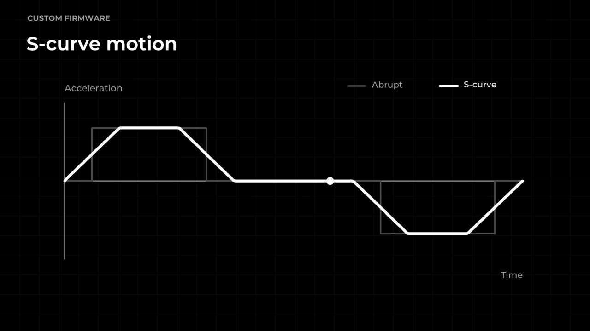](assets/readme/videos/s-curve.mp4) | [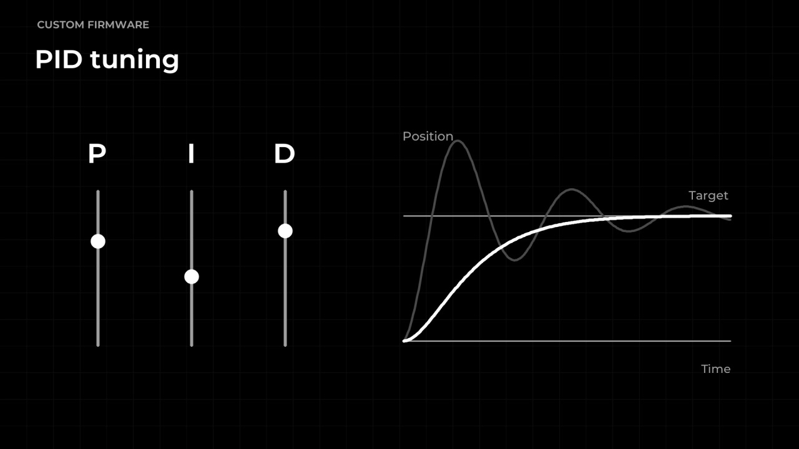](assets/readme/videos/pid-tuning.mp4) |
| **Velocity feedforward** | **Gravity compensation** |
| [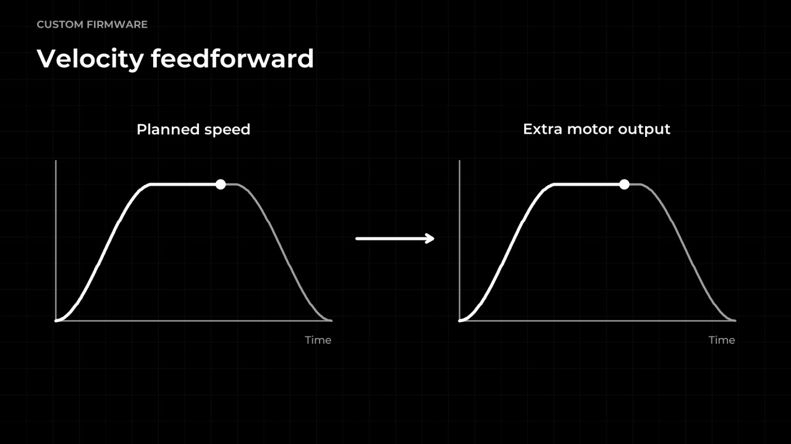](assets/readme/videos/velocity-feedforward.mp4) | [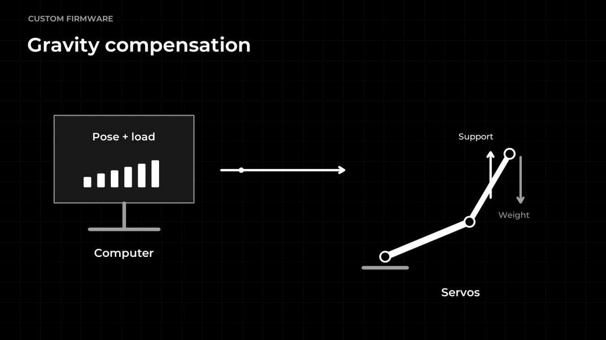](assets/readme/videos/gravity-compensation.mp4) |

These explanatory graphics and animations are conceptual, not measured hardware plots.
See the [technical reference](TECHNICAL_REFERENCE.md) for settings, protocol
details and limitations. Extension clients must support **protocol v9.0**;
extension settings are temporary and must be sent again after a reset or power cycle.

## Results on SO-101 / SO-102

The clips below show recorded before-and-after tests on SO-101 and SO-102.
Each comparison shows the original behavior first, followed by the
custom-firmware setup.

| SO-101: before, then after | SO-102: before, then after |
| --- | --- |
|  |  |

The approximate values shown describe these demonstrations, not guaranteed
accuracy across the arm's workspace. Repeatability, absolute positioning
accuracy and mechanical deflection are different measurements.

### Complete coordinated movement

This clip preserves the complete recorded movement. Each servo plans locally;
sending targets together does not by itself guarantee simultaneous arrival.

### Mechanical limitations

Gearbox backlash and frame flex still affect the arm's endpoint position.
Controller tuning does not remove these mechanical limitations. Validate
settings on the actual mechanism and load; see
[current limits](TECHNICAL_REFERENCE.md#current-limits).

## Robots and links

Interested in building a similar setup? Explore the SO-ARM101 and SO-ARM102 kits
from Robonine. Kit contents are documented on the product pages.

| SO-ARM101 | SO-ARM102 |
| --- | --- |
|  |  |
| [Buy the SO-ARM101 kit from Robonine](https://robonine.com/ru/shop/so-arm101-black-white-robotic-arm-kit/) | [Buy the SO-ARM102 kit from Robonine](https://robonine.com/ru/shop/so-arm102-robotic-arm-kit/) |

[Explore SO-ARM102 hardware, CAD and BOM](https://github.com/roboninecom/SO-ARM102).

## Quick start

Follow the **[existing Quick start guide](QUICKSTART.md)** for the prerequisites,
commands, checks and flashing precautions. Its setup sequence is:

1. Install the required tools and select the servo port.
2. Back up motor settings and flash the published custom firmware.
3. Calibrate joint offsets and travel limits as required for the setup.
4. Check communication with torque off.
5. Record poses, preview replay and perform the first motion test.

The same guide continues with gravity compensation, tuning and visualization.
**Flashing can damage the servo or erase calibration.** Follow the guide's
power, torque and recovery precautions before proceeding.

[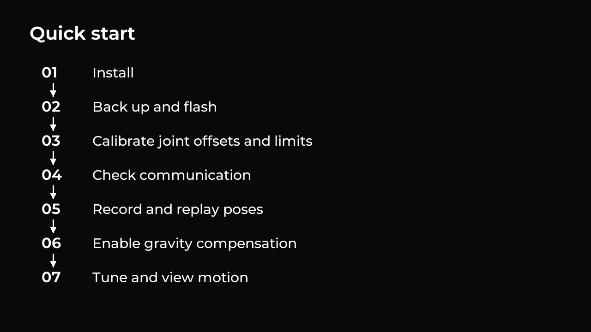](QUICKSTART.md)

For a new SO-101 or SO-102 calibration, use the existing reference-pose images
and follow the [calibration guide](tools/settings/README.md#reference-pose-images).
Keep an existing verified calibration when reusing its recordings and gravity model.

| SO-101 reference pose | SO-102 reference pose |
| --- | --- |
|  |  |

## Detailed documentation

The complete original documentation is preserved verbatim in
**[TECHNICAL_REFERENCE.md](TECHNICAL_REFERENCE.md)**, including every command,
register table, formula, unit, limitation and warning.

- [Legacy mode](TECHNICAL_REFERENCE.md#legacy-mode)
- [How extension mode works](TECHNICAL_REFERENCE.md#how-extension-mode-works)
- [S-curve motion](TECHNICAL_REFERENCE.md#s-curve-motion)
- [Calibration reference poses](TECHNICAL_REFERENCE.md#calibration-reference-poses)
- [PID controller](TECHNICAL_REFERENCE.md#pid-controller)
- [Velocity feedforward](TECHNICAL_REFERENCE.md#velocity-feedforward)
- [Gravity compensation](TECHNICAL_REFERENCE.md#gravity-compensation)
- [Starting and stopping extension mode](TECHNICAL_REFERENCE.md#starting-and-stopping-extension-mode)
- [Extension protocol](TECHNICAL_REFERENCE.md#extension-protocol)
- [Extension registers](TECHNICAL_REFERENCE.md#extension-registers)
- [Build and verification](TECHNICAL_REFERENCE.md#build-and-verification)
- [Repository layout](TECHNICAL_REFERENCE.md#repository-layout)
- [Current limits](TECHNICAL_REFERENCE.md#current-limits)

Technical overview diagrams

These diagrams summarize concepts; the linked reference sections contain the
full requirements and procedures.

| Legacy mode | Extension session |
| --- | --- |
| [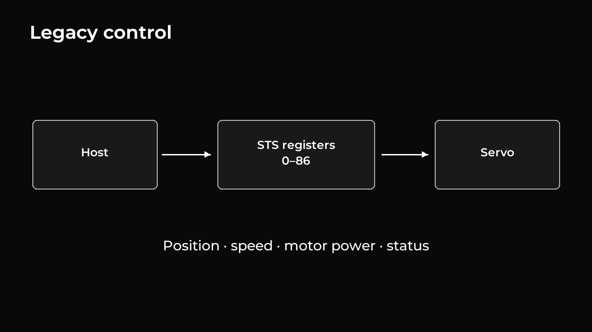](TECHNICAL_REFERENCE.md#legacy-mode) | [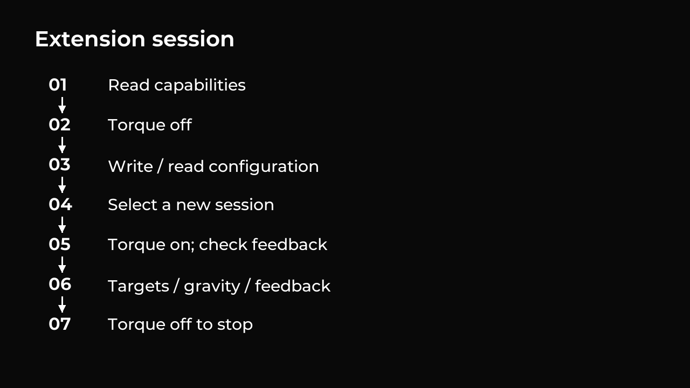](TECHNICAL_REFERENCE.md#starting-and-stopping-extension-mode) |
| **Extension protocol** | **Extension registers** |
| [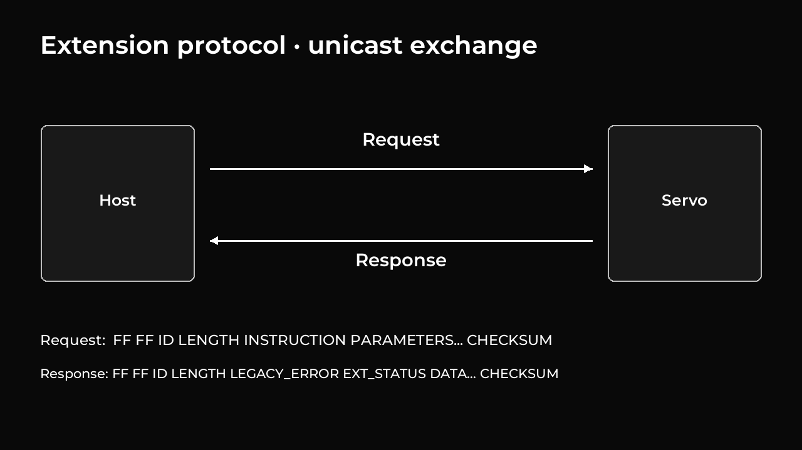](TECHNICAL_REFERENCE.md#extension-protocol) | [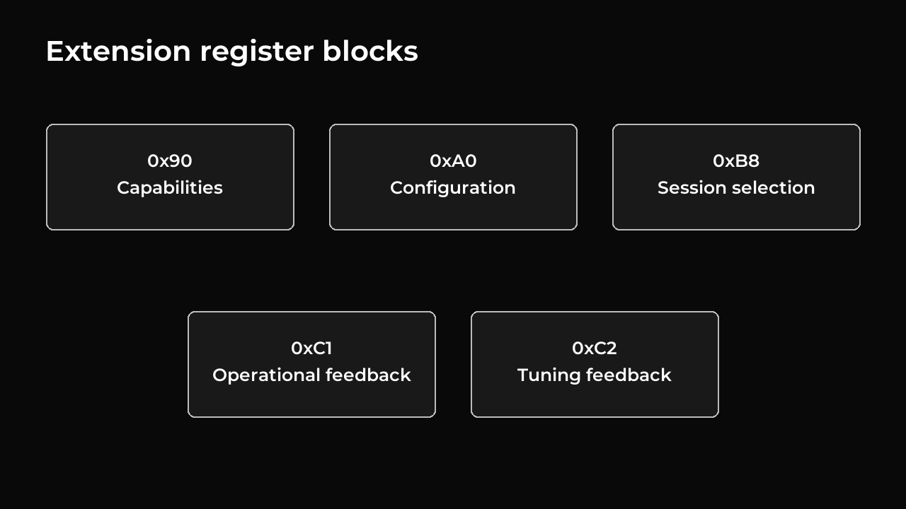](TECHNICAL_REFERENCE.md#extension-registers) |
| **Build and verification** | **Repository layout** |
| [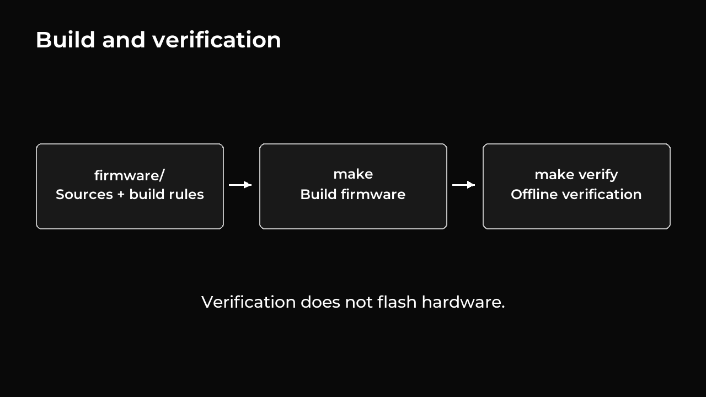](TECHNICAL_REFERENCE.md#build-and-verification) | [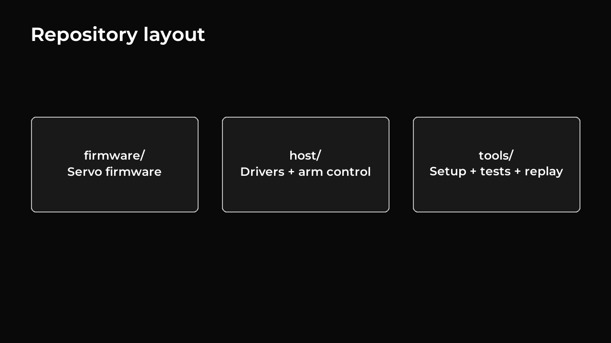](TECHNICAL_REFERENCE.md#repository-layout) |

See [tools](tools/README.md) for individual command guides and
[firmware](firmware/README.md) for the build toolchain.
