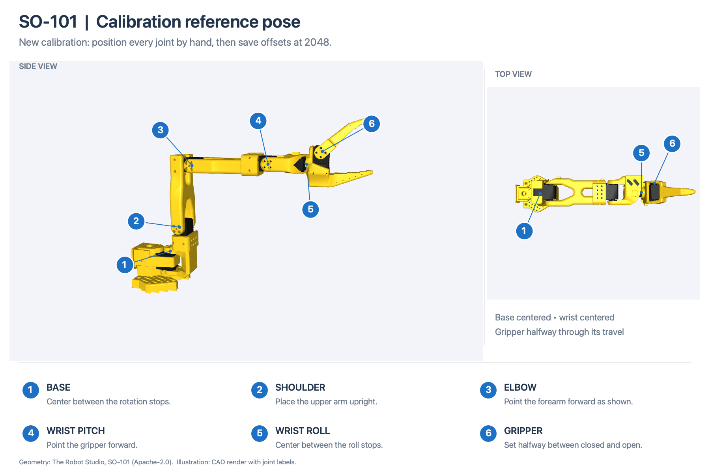
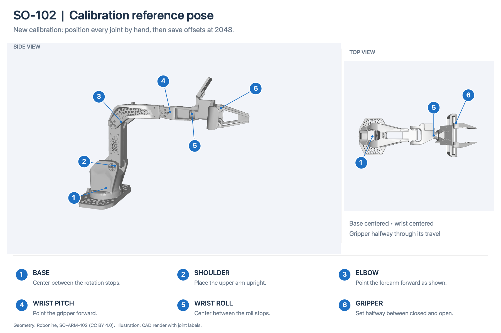

# Discovery, calibration and settings

Find STS servos and back up or restore their persistent legacy settings. Uses the
repository's shared driver and STS control table. Requires Node.js 20 or newer.
Run these commands from the repository root after `npm ci`.

## Discover

```sh
npm run settings -- discover --port /dev/cu.usbmodemYOUR_ADAPTER
```

Lists responding motor IDs and reported alarms as JSON. Discovery is read-only
and scans the selected baud rate, which defaults to 1,000,000. Add
`--baud 500000` for a different supported rate. On Linux or Windows, use your
adapter's port, such as `/dev/ttyUSB0` or `COM3`.

Motors must have unique IDs. Discovery cannot reliably distinguish motors that
share an ID, or find motors using another baud rate.

## Back up

```sh
npm run settings -- backup --port /dev/cu.usbmodemYOUR_ADAPTER --id 2 \
  --file tools/settings/backups/servo-2.json
```

Saves device identity and every persistent setting described by the shared
control table, including calibration, limits, gains, ID and baud selector.
Backup only reads the motor. Existing files are never overwritten. Without
`--file`, a timestamped file is created under `tools/settings/backups/`, which
is ignored by Git.

## Restore

Connect only the motor being restored, disable torque, lock settings and clear
active alarms. Close other programs using the port. Use a backup from the same
motor: restoring another motor's calibration can change its reported position.

```sh
npm run settings -- restore --port /dev/cu.usbmodemYOUR_ADAPTER --id 2 \
  --file tools/settings/backups/servo-2.json
```

`--id` and `--baud` describe the **current connection**. The backup may restore a
different ID or baud rate; the tool follows those changes and reports the final
connection. It checks model identity, writes only changed settings, waits for each saved
register range to finish, reads the settings back and relocks the motor. It never enables torque or sends a motion command. A failed
restore may leave some settings changed; inspect the error before retrying.

These backups cover legacy settings, not extension configuration or the factory
reset template. For repair after flashing factory firmware over custom firmware,
use the [factory settings recovery tool](../flash/README.md#restore-factory-settings). Its backup
files use a different format and are not interchangeable with this tool's JSON.

## Calibrate joint offsets and limits

Calibrate 1–6 motors with unique IDs from 1 to 253 and mechanically bounded joint
travel. Supports GD32 STS model family 9, including mixed motor variants,
in position mode with a position divisor of 1. Close other serial tools.

```sh
npm run settings -- calibrate --port /dev/cu.usbmodemYOUR_ADAPTER --ids 1,2,3 \
  --file tools/settings/calibrations/arm.json
```

Replace the example IDs with your motors. Omit `--ids` to calibrate all discovered
motors, up to six. An explicit selection leaves other connected motors unchanged.
No joint names, arm geometry or standard reference pose are assumed.

### Choose the reference pose

The **calibration reference pose** is the physical pose you capture in step 1.
The tool makes each selected motor report **2048 at that pose**. It does not
recognize the pose, infer joint angles, or calculate it from the later sweep.

For a new calibration, place each joint near the middle of its mechanical travel
and choose a position you can reproduce. Include wrist roll and the gripper;
do not assume the gripper should be fully open or closed. Use the same physical
pose each time. If the mechanism has a documented reference pose, follow it.
For SO-101, the [LeRobot calibration guide and video](https://huggingface.co/docs/lerobot/so101#calibrate)
show the mid-travel placement followed by an end-to-end sweep.

### Reference pose images

For a **new calibration**, use the guides below. Labels assume the usual motor
IDs 1–6. Place the base upright, the upper arm upright, and the forearm and
gripper pointing forward as shown. Center the base rotation and wrist roll
between their mechanical stops; set the gripper halfway between closed and open.
Use the physical travel to find these positions, not the uncalibrated counts.

#### SO-101



#### SO-102



The images illustrate manual placement for new offsets. They do not establish
compatibility with an existing tuned gravity model. The default viewer maps also
use different wrist/gripper reference values: update the mapping if you calibrate
to these poses. [Image sources and model angles](images/README.md).

The full travel must fit within 0–4095 after the reference becomes 2048: at most
2048 counts below the reference and 2047 above it. A joint with nearly a full
turn of travel needs particularly careful centering. A repeatable pose near an
end stop may not leave enough room, even when total travel is less than a turn.

If you intend to use a simulator or gravity model, its angle convention must
match this physical pose. **2048 is not automatically zero degrees in the
model.** See the [viewer mapping](../simulation/README.md#models-and-calibration)
and [gravity model requirements](../../host/arm-control/models/README.md).
Keep an already verified calibration when reusing its recordings and model;
a firmware flash that preserves settings does not require recalibration.

### Capture offsets, then limits

One command guides both steps:

1. **Reference pose:** place the selected joints in a repeatable pose chosen for
   your mechanism. Support it, hold still and press **Enter**. The tool writes
   motor offsets so every selected joint reads **2048** at the captured pose,
   then verifies the saved registers.
2. **Joint limits:** move each selected joint from end to end. Pause briefly at
   each end; do not force stops. Review the live minimum,
   maximum, midpoint and travel counts, then press **Enter**. The tool writes
   limits with **10 counts of clearance** inside each measured endpoint.

The table's **Middle** is `(Min + Max) / 2`, rounded to a whole count. It is
informational: saving limits does not move 2048 to that midpoint or change the
offsets. Asymmetric limits are valid.

If motors are powered at startup, the tool asks you to support the mechanism before
releasing torque. Otherwise there are only the two prompts above. No motion is
commanded; torque remains off and settings are locked after saving.

Reference capture uses the median of several readings. Small hand movements do
not stop calibration, and moving slightly while offsets are saved does not
require another confirmation.
Failed settings saves remain beside the affected motor and retry automatically.
The tool reads back before retrying a write, so a missing acknowledgement does
not cause already-saved settings to be written again. Completed motors are kept;
no extra confirmation is needed.

Offsets are saved before the sweep and are not changed when limits are saved.
Limits may be asymmetric around 2048. Encoder wraparound is tracked; a range
crossing 0 or 4095 cannot be stored as ordinary limits and shows `crosses zero`
in the **Check** column. Every joint must move at least 64 counts and less than
a full turn before its limits can be saved.

Temporary read errors appear beside the affected motor and clear automatically
when valid readings resume. Faster hand movement does not trigger a speed-limit
error. Enter saves only when all ranges are valid; otherwise recording continues
with the measurements retained. Use `reset 2` to clear only M2's measured range
and sweep that joint again, without repeating the reference step or other joints.
A genuine range crossing zero still needs its reference placement corrected;
resetting the measurements cannot make that physical range fit. All motor errors stay visible beside the affected motor. Alarms or unexpected
torque pause its settings writes until cleared; lost connections are retried.
The session remains open and retains completed work. During automatic retries,
press Ctrl+C to cancel.

The output file is overwritten on each run. Motor backups are kept in a unique
directory under `backups/` beside that file and can be used with `settings restore`.
The report records reference readings, offsets, measured ranges and completed
writes; it does not store a photograph or physical joint angles.
Only `status: "verified"` means both steps completed.

Type `cancel` or press Ctrl+C to stop. **Offsets already saved in step 1 remain
saved if step 2 is cancelled or fails; the old limits remain until replaced.**
Complete calibration before enabling motion. You can rerun the same command
from the reference pose, without restoring a previous calibration JSON.

### Expected travel warnings

Optionally pass `--expected-ranges FILE.json` containing verified travel counts
and tolerances, keyed by motor ID. Example format:

```json
{"1": {"counts": 2000, "tolerance": 100}}
```

These numbers only illustrate the file format. Deviations are displayed
as warnings; pressing Enter accepts the measured range. Omitted joints have no
expected-range check.

Finish calibration before recording poses or fitting gravity compensation.
After changing offsets, record poses again and update or refit the gravity model
and simulator mapping. Neither is updated by this command. Copying another arm's
offsets, or changing only a model's calibration-check fields, does not establish
the correct relationship between counts and angles.

## Help and tests

```sh
npm run settings -- --help
npm run test:settings
```

Tests run offline without opening a serial port. Commands exit with a nonzero
status on failure; an empty discovery list means no replies at the selected baud.
